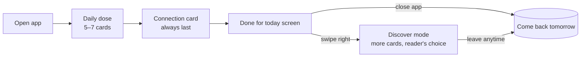
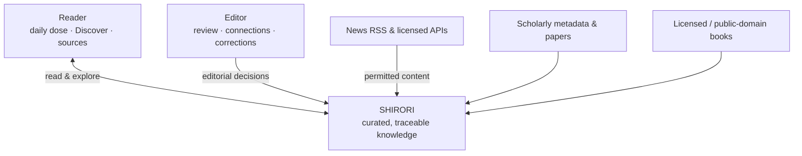
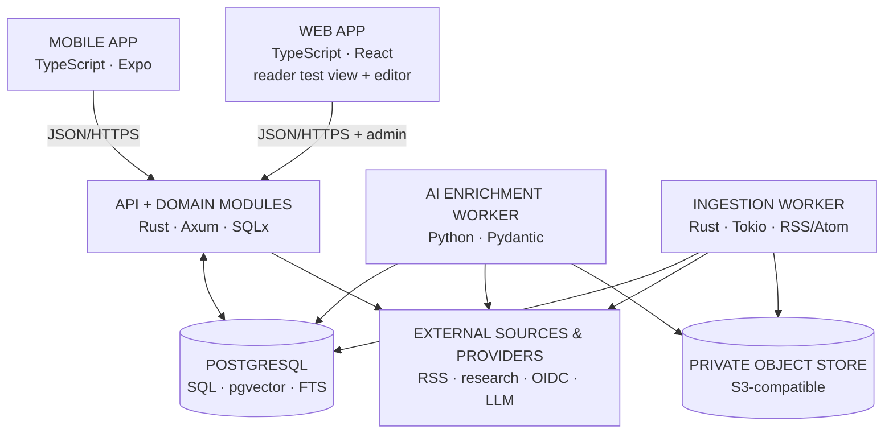
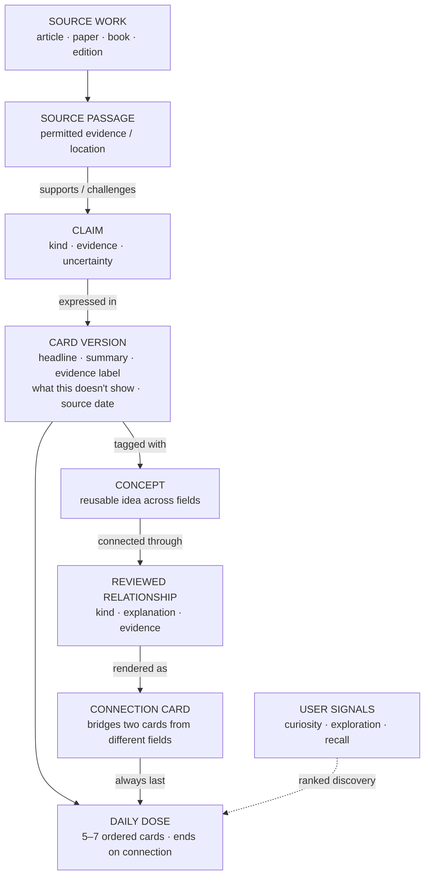
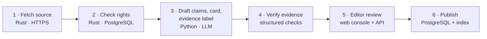
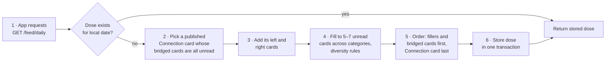
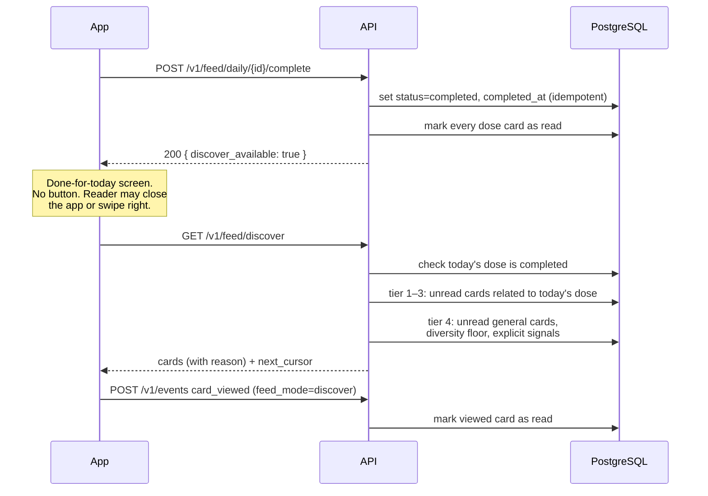
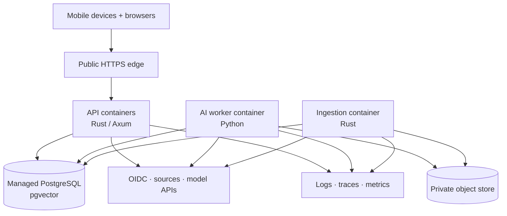

# Shirori — arc42 Software Architecture

| | |
|---|---|
| **Status** | Proposed / design baseline (not an implemented system) |
| **Version** | 0.2 |
| **Date** | 6 November 2026 |
| **System** | Shirori — a finite daily dose of source-first knowledge, with an optional Discover mode |
| **Audience** | Founders, backend/mobile developers, AI engineers, content editors, privacy and security reviewers |
| **Architecture style** | Modular monolith with separately deployed asynchronous workers |

**Purpose of this document.** Describe the proposed architecture, boundaries, languages, technology stack, data flows, operational responsibilities and important design decisions for the Shirori MVP. All technology choices and numerical quality targets are **proposals to validate**, not claims about an existing deployment.

**Document conventions.** **Chosen** = preferred MVP decision. **Candidate** = useful option that needs a spike. **Deferred** = intentionally not part of the MVP. Diagrams are logical views, not deployed-system screenshots.

## What changed since v0.1

| # | Change | Why |
|---|---|---|
| 1 | Product name fixed to **Shirori** everywhere (v0.1 said "Shiori"). | One name for crates, database, app and docs. |
| 2 | **Daily dose + Discover mode** replaces the open-ended "Explore" feed. The daily dose is finite (5–7 cards) and ends on a "done for today" screen. After that, and only after that, the reader can **swipe right into Discover mode** to keep reading. `GET /v1/feed/explore` became `GET /v1/feed/discover`. | The debate agreed the dose must end. Discover is an explicit choice the reader makes after finishing, never the default. |
| 3 | **The last card of every daily dose is a Connection card** linking two earlier cards from that dose, which come from different fields. | This is the product's main differentiator, so the architecture has to guarantee it. |
| 4 | Card versions now carry an **evidence label**, a **"What this doesn't show"** line and a **source date**. | "Honesty has to be on the card, not in the About page." |
| 5 | **The religion rule** now follows the debate's recommended wording. The public line and the internal rule are listed in §2.2. | v0.1 said "including ideas from religious texts", which conflicted with core value #4. |
| 6 | **No streaks and no guilt notifications** became an explicit product constraint (§2.3). | All four debate roles agreed. |
| 7 | **Read cards never repeat.** Once a reader has read a card, it never appears again in a later dose or in Discover. Things that are *important and related* to today's dose (follow-ups, updates, corrections, reviewed connections) are ranked **first in Discover**, as new cards. | Every swipe should teach something new. Follow-up depth goes to where a curious reader looks next. |
| 8 | **Discover is a swipe, not a button.** There is no Discover button, tab, icon or badge. The reader swipes right from the done screen, and that's it. | Discover should feel like continuing towards knowledge, not like an Instagram-style "Explore" destination. |
| 9 | **Saving cards is a first-class feature.** Readers can save any card (dose, Connection or Discover) to a personal Saved list, unsave it, and come back to it any time. Saved is the one deliberate way to see a read card again. | Readers need to keep the ideas that matter to them without breaking the no-repeat feed. |

## Architecture at a glance

| Concern | MVP choice | Primary language / technology |
|---|---|---|
| Mobile experience | React Native with Expo, typed API client | TypeScript, React Native, Expo |
| Test web page / editorial console | Small web app: reader view + editor view | TypeScript, React, Vite (Next.js later if needed) |
| Public application API | Modular monolith, JSON/HTTPS | Rust, Axum, Tokio, SQLx |
| Source ingestion | Scheduler and fetch/parse workers | Rust, Tokio, reqwest, RSS/Atom parsing |
| AI-assisted enrichment | Bounded asynchronous pipeline | Python, Pydantic, configurable LLM/embedding adapters |
| Main database and search | Transactional data, full-text search and vectors | PostgreSQL, SQL, pgvector |
| Background work coordination | Durable jobs within PostgreSQL | SQL (`FOR UPDATE SKIP LOCKED`), Rust/Python workers |
| Search and related concepts | Hybrid lexical + vector retrieval; reviewed graph edges | PostgreSQL FTS, pgvector, SQL, Python embeddings |
| Object storage | Licensed/approved artefacts and operational files | S3-compatible object storage, signed access |
| Identity and access | Standards-based identity, token verification, roles | OpenID Connect / OAuth 2.0, JWT or opaque token validation |
| Monitoring and release | Structured logs, tracing, metrics and CI/CD | OpenTelemetry, Prometheus/Grafana (candidate), GitHub Actions, Docker |

---

## 1. Introduction and Goals

### 1.1 Product vision

Shirori replaces doomscrolling with a **daily dose of knowledge**: short, swipeable cards drawn from four kinds of sources:

1. Useful ideas and values from **books**, including secular philosophy such as Stoicism and Confucianism
2. Important findings from **research papers**
3. **News** from genuine, reputable publishers
4. **Evergreen knowledge** from verified sources

**Core values.**

1. Source transparency
2. Intellectual honesty
3. Depth on demand: the original source is one or two taps away
4. Insights backed by evidence or a clearly cited argument (see the religion rule in §2.2)

**Differentiator:** *Shirori connects knowledge across fields.* Every daily dose ends with a Connection card that links two of that day's cards from different fields in one plain sentence.

**Reader journey.**



- The app always opens on **today's dose**, or on the done screen if the dose is finished. It never opens in Discover mode.
- **Discover mode** is a deliberate opt-in: a swipe right from the done screen. It serves more reviewed, informative cards under the same honesty rules. The daily dose is the ritual, and Discover is an extra.
- **Discover is not a button.** There is no Discover button, tab, icon or badge anywhere in the app. The only way in is to keep swiping towards knowledge from the done screen.
- **Nothing repeats.** A card the reader has read never comes back in a later dose or in Discover. When something important relates to today's dose (a follow-up on a news story, an update or correction, a reviewed connection), it appears as a **new** card at the top of Discover. The reader can still revisit cards on purpose through Saved.
- The exact dose length (5–7 cards) and the Discover guardrails are product hypotheses to test.

### 1.2 Functional requirements

| ID | Capability | MVP expectation |
|---|---|---|
| FR-01 | Finite daily dose | Serve 5–7 reviewed cards per reader per local day across the four source categories. The dose is stable for the day: re-requesting it returns the same cards. |
| FR-02 | Connection card | The final card of every dose is a Connection card that links two earlier cards in the same dose, which come from different fields, using a reviewed relationship. |
| FR-03 | Done screen | After the Connection card, show a clear "you're done for today" state and record dose completion. |
| FR-04 | Discover mode | Available only after today's dose is completed. Entered **only** by swiping right from the done screen; no button, tab or icon. Cursor-paginated reviewed cards with a diversity floor. |
| FR-04a | Related-first Discover ranking | The first Discover ranks are cards that are important and related to today's dose: follow-ups/updates to the same story, corrections, then cards linked by reviewed connections or shared concepts. General diversity-aware Discover follows. |
| FR-04b | No repeats | A card the reader has read is never served again in any dose or in Discover. Related material is always a different card. Saved cards stay available through Saved. |
| FR-05 | Honest card face | Every card shows its source, source date and evidence label, plus a "What this doesn't show" line when required (§8.2). |
| FR-06 | Content provenance | Expose the original source, author/publisher, publication date, references and card version. |
| FR-07 | Depth on demand | Open work, article or paper metadata; read permitted content or link to the source in one tap. |
| FR-08 | Knowledge connections | Show explainable, reviewed links between cards or concepts. |
| FR-09 | Content ingestion | Poll approved feeds/APIs and import permitted book or reference material. |
| FR-10 | Editorial control | Draft, verify, approve, revise, withdraw and audit cards and connections. |
| FR-11 | Like and share | Readers can like and share any card. |
| FR-11a | Save cards | Readers can save any card from the dose, a Connection card or Discover with one tap, and unsave it the same way. A Saved list (newest first) lets them reopen saved cards at any time, with full source links and labels. Saving works whether or not the reader has consented to analytics. Saved cards are included in data export and deleted with the account. |
| FR-12 | Curiosity feedback | Optional checkpoints ask what the reader wants to explore next. Always skippable. |
| FR-13 | Learning signals | Keep expressed interest, exploration and demonstrated understanding separate. |
| FR-14 | Search | Search cards, topics and sources. |
| FR-15 | Preference and privacy control | Let readers adjust categories, export their data and delete their account. |
| FR-16 | News lifecycle | Identify evolving news and support updates, corrections and withdrawal. |
| FR-17 | Religion rule | Enforce the rule in §2.2 at the claim level. Religious texts appear only as clearly labelled historical or literary sources. |

**Explicit MVP non-goals:** fully autonomous publishing; streaks or guilt-driven notifications; Discover as the default landing screen; unrestricted scraping or redistribution of copyrighted full text; a real-time breaking-news desk; behavioural advertising; inferred religious/political identity; a production-scale graph database; complex deep-learning ranking before there is validated event data.

### 1.3 Quality goals and stakeholders

Priority quality goals: **(1) trust and provenance**, **(2) a finite, healthy reading habit**, **(3) user privacy and safety**, **(4) meaningful discovery across fields**, **(5) operability and cost control**, **(6) maintainability**. Performance matters, but a fast inaccurate card is not a successful result.

| Stakeholder | Concern / expected outcome |
|---|---|
| Reader | A short daily dose that ends, transparent sources, honest labels, optional deeper reading, control over recommendations. |
| Content editor | Evidence trails, a clear review queue, connection authoring, correction and withdrawal tools. |
| Product owner | Week-4 return without streaks, Connection-card engagement, source opens, content economics. |
| Backend engineer | Predictable domain boundaries, simple deployments and testable APIs. |
| AI engineer | Reproducible prompts, evaluation datasets, traceable model outputs and bounded costs. |
| Security/privacy reviewer | Data minimisation, access controls, consent and deletion workflow. |
| Operations engineer | Reliable jobs, alerts, backup/restore and incident visibility. |

---

## 2. Architecture Constraints

### 2.1 Technical and team constraints

- **Small-team MVP:** prefer managed infrastructure and a **modular monolith** over multiple distributed services.
- **Rust-led backend:** API, domain logic, ingestion scheduler and network fetchers in Rust. Python only where AI tooling makes it useful.
- **Mobile-first:** iOS and Android from one React Native/Expo codebase, plus a responsive web app for testing and editorial work.
- **Source-first:** no card may be published without a persistent source reference and an auditable editorial decision.
- **Human oversight:** AI may help with drafting, tagging and suggesting candidate connections. It cannot make the final publication decision.
- **Provider flexibility:** vendor names and model versions are adapter/configuration concerns, not domain concepts.

### 2.2 Legal, editorial and ethical constraints

- UK-focused privacy and data-protection design. Get jurisdiction-specific legal review before launch.
- News RSS, scholarly metadata and public web pages **do not automatically grant republication rights**. Track the licence, permissions, access scope, permitted transformations and retention per source.
- Books and translations need rights checks for the relevant jurisdiction and edition. Prefer public-domain works or explicit licences, and link out when republication is not permitted. Write short, original takeaways with clear credit instead of close paraphrase.
- **Religion rule.**
  - **Public line:** *"Insights backed by evidence or a clearly cited argument."*
  - **Internal rule:** *Shirori never presents a claim as true because a sacred text or religious authority says so. We include philosophy (such as Stoicism and Confucianism), academic research about religion, and scientific studies of practices like meditation. A religious text may be quoted only as a clearly labelled historical or literary source, never as advice or proof.*
  - **Enforcement:** a claim whose only support is a religious text must have `claim_kind = historical` (or a literary attribution) and cannot be a card's primary normative or empirical claim. The publication gate checks this (§8.2).
- Do not infer sensitive identity attributes (such as religion or political affiliation) from reading behaviour. Interest in a text is not identity.
- Design accessibility, corrections, unsubscribe and account deletion as foundational capabilities.

### 2.3 Product constraints (from the idea debate)

- **The daily dose ends.** The dose endpoint returns a fixed list, never a cursor. The done screen is a real state, not an advert for Discover.
- **Discover is opt-in and gated.** The server only serves Discover after today's dose is completed. The client only offers it from the done screen.
- **Discover is a swipe, not a button.** No button, tab, icon, badge or notification points to Discover. The done screen may show at most a quiet text hint of the swipe direction (candidate, first-time readers only).
  - **Accessibility:** WCAG 2.2 success criterion 2.5.1 (Pointer Gestures) requires a non-swipe way to do the same thing. Provide it as a screen-reader custom action ("Continue to Discover") and a keyboard arrow-right on the web. Neither is a visible button.
- **Nothing the reader has read repeats.** The server tracks read cards per reader and excludes them from every future dose and from Discover.
- **No streaks and no guilt notifications.** No "you broke your streak" messages and no loss-framed reminders. A positive weekly recap ("connections you collected this week") is allowed later.
- **Success is not time spent.** Product metrics are dose completion, week-4 return, source opens and Connection-card engagement. Discover session length is observed but not optimised (§10.2).

---

## 3. Context and Scope

### 3.1 Business context

Shirori sits between the reader and information providers. Its value is **selection, context, attribution, connections across fields and honest labelling**, not ownership of the original content.



### 3.2 Technical context and interfaces

| External system | Interface / format | Data and trust consideration |
|---|---|---|
| News publisher / aggregator | RSS/Atom over HTTPS; licensed APIs | Untrusted content. Respect robots/ToS/licence and rate limits. |
| Scholarly sources | HTTPS APIs (OpenAlex, Crossref); DOI, identifiers, metadata, permitted full text | Reconcile metadata and licences. Pick up retraction signals. |
| Book collections / rights holders | EPUB, structured text, metadata, contractual feed | Import only permitted content. Preserve edition and translator. |
| LLM and embedding provider | Authenticated HTTPS API or controlled local model | Send only content allowed by rights and the data-processing policy. |
| Identity provider | OIDC/OAuth 2.0 | Verify issuer, audience, signature, expiry and scopes. |
| Object store | S3-compatible API | Private objects, constrained access, lifecycle controls. |
| Push provider (optional, later) | Expo push / APNs / FCM | Separate notification consent. No streak or guilt messages. |

**Trust boundaries:** external content and AI outputs are untrusted. Editorial/admin capabilities are privileged. Client telemetry is not authoritative. PostgreSQL is the transactional source of truth. Requests and third-party content must be authenticated and validated before crossing boundaries.

---

## 4. Solution Strategy

### 4.1 Fundamental approach

1. **One Rust application API:** Axum routing into domain modules with explicit service/repository boundaries.
2. **Asynchronous data plane:** Rust ingestion jobs and Python AI enrichment jobs, using durable PostgreSQL job records.
3. **Canonical knowledge model:** source works → evidence/claims → versioned cards → concepts and reviewed connections.
4. **Editorial publication gate:** machine checks are separate from human approval. Only approved versions enter public feeds.
5. **Two feed modes, one card pool:** the **daily dose** is a finite, stored, per-reader list that ends on a Connection card. **Discover** is a cursor-paginated stream that unlocks once the dose is complete. Both serve only published card versions.
6. **Hybrid but simple ranking:** rule-based eligible candidates, lexical/vector similarity and diversity constraints first, with evidence-informed improvements later.
7. **Designed for reversibility:** provider adapters, an optional future message broker, and schema evolution through migrations.

### 4.2 Technology choice rationale

- **Rust/Axum/SQLx:** strong typing, predictable resource use and shared logic with the ingestion stack. Tokio supports asynchronous I/O.
- **Python/Pydantic:** a broad NLP and evaluation ecosystem, validated structured outputs and easier model experiments.
- **PostgreSQL + pgvector:** one database for transactions, full-text search, embeddings and modest-size graph relationships.
- **TypeScript/React/Expo:** one language for the test web page, the editorial console and the mobile app, with type-safe API contracts.
- **Docker + managed services:** reproducible local environments with few production components.

---

## 5. Building Block View

### 5.1 Level 1: system containers



### 5.2 Technology and responsibility matrix

| Component | Language | Frameworks / technology | Responsibilities and boundaries | MVP status |
|---|---|---|---|---|
| Mobile app | TypeScript | React Native, Expo, Expo Router, typed HTTP client | Daily dose, done screen, swipe-right into Discover (gesture + accessibility action, no button/tab), source viewer, saved, preferences. No ranking logic or secrets. | Chosen |
| Web app (test reader + editor) | TypeScript | React, Vite; Next.js candidate later | Phone-sized reader view for testing the dose/Discover flow. Editor view for review queue, connections, publish/correct/withdraw. | Chosen |
| Public API | Rust | Axum, Tokio, serde, SQLx, tracing | Authentication, versioned JSON API, pagination, access rules. | Chosen |
| Feed (dose + Discover) | Rust | Domain module, SQLx, pgvector queries | Daily dose assembly with a final Connection card; read-card exclusion; dose completion; Discover gating, related-first ranking, cursor pagination and diversity. | Chosen |
| Search & connections | Rust + SQL | PostgreSQL FTS, pgvector, relational edge tables | Keyword/semantic search, concept browsing, explanations for reviewed links. | Chosen |
| Feedback & checkpoint engine | Rust | Axum domain module, SQLx | Store explicit curiosity signals; decide if and when to offer optional checkpoints. | Chosen |
| Content/catalogue domain | Rust | SQLx, PostgreSQL | Works, editions, cards, provenance, versioning, evidence labels, publication state. | Chosen |
| Editorial workflow API | Rust | RBAC middleware, SQLx | State transitions, review assignment, audit events, withdraw/revise, publication-gate checks. | Chosen |
| Ingest scheduler / parser | Rust | Tokio, reqwest, RSS/Atom parser, serde | Source polling, conditional GET, retry/backoff, canonicalisation, dedupe. | Chosen (after first slice) |
| AI enrichment worker | Python | Pydantic, HTTP client, model/embedding adapters | Bounded summaries, claim extraction, evidence-label suggestions, topic tags, candidate connections. No direct public publishing. | Chosen (after first slice) |
| Durable job queue | SQL + Rust/Python | PostgreSQL transactional jobs, `SKIP LOCKED` | Claim, retry, dead-letter, idempotency for ingestion/enrichment. | Chosen |
| Database | SQL | PostgreSQL, pgvector, built-in FTS | Durable domain state, audit and event tables, indexes. | Chosen |
| Artefact storage | n/a | S3-compatible private object store | Rights-approved artefacts, exports, review attachments. | Chosen (later) |
| Identity | Protocols | OIDC/OAuth 2.0, managed IdP **TBD** | Login and token issuance. The API verifies tokens and enforces RBAC. A dev-token mode is used for local testing. | Provider TBD |
| CI/CD and packaging | YAML / shell | GitHub Actions, Docker Compose, container registry; Terraform optional | Lint, test, build, migrations, release. | Chosen |
| Observability | Rust/Python instrumentation | OpenTelemetry, structured logs, metrics backend **TBD** | Traces, job health, API latency, error alerts, cost dashboards. | Chosen / provider TBD |
| Graph database | — | Neo4j | Not needed: concept nodes and edges live in PostgreSQL. | Deferred |
| Message broker | — | RabbitMQ / Kafka / managed queue | Only when Postgres jobs no longer meet scale/isolation needs. | Deferred |
| ML ranker | Python + Rust serving | Offline ranking experiments | Only once logged outcomes and offline/online tests support it. | Deferred |

### 5.3 Rust API internal modules

| Module | Owns | Calls / depends on |
|---|---|---|
| `auth` | Token validation, roles, permissions | Identity adapter; policy rules |
| `catalogue` | Work/source/card read models, evidence labels, publication status | PostgreSQL repositories |
| `feed` | Daily dose assembly and completion; read-card ledger; Discover gating, related-first ranking and pagination | Catalogue, knowledge, recommendations, read-card repository |
| `recommendations` | Interest and diversity rules, eligibility and ranking | Profile projections, indexed cards |
| `knowledge` | Concepts, edges, connection rationale, Connection cards | Catalogue and search repositories |
| `search` | Keyword/semantic retrieval, pagination | PostgreSQL FTS and pgvector |
| `feedback` | Event validation, telemetry consent, like/share signals | User and event stores |
| `saved` | Reader's Saved list: save, unsave, list; resolving saved cards to their current published version or a correction notice | Catalogue, user store |
| `checkpoints` | Question selection, response capture, limits | Feedback/profile stores |
| `editorial` | Review state machine, publication gate, corrections and audit | Catalogue, jobs, audit store |
| `users` | Account preferences, time zone, exports and deletion | Identity mapping and user store |

**Dependency rule:** HTTP handlers → application services → domain types/interfaces → repositories/adapters. Business modules must not import another module's HTTP handlers or write directly to another module's tables outside declared repository boundaries. Use explicit transactions for cross-module invariants.

### 5.4 Conceptual domain data model



**Important fields (illustrative, not a full migration):**

- **`source_work`**: id, source_id, type (`article | paper | book | reference`), title, author, canonical_url, doi_or_isbn, edition, publication_at, licence_id, rights_status, language, updated_at.
- **`claim`**: id, statement, claim_kind (`empirical | historical | reported | interpretive | normative`), uncertainty, review_status.
  - *Thin slice:* until the claim tables land with AI-assisted drafting (step 4), each `card_version` carries the `claim_kind` of its primary claim, and the publication gate applies the religion rule to it.
- **`claim_evidence`**: claim_id, passage_id, locator, stance, evidence_notes. Passage text is retained **only when authorised**. A flag `is_religious_text` on the work drives the religion rule.
- **`card`**: id, primary_work_id (null for Connection cards), category (`book | research | news | evergreen | connection`), field (e.g. `psychology`, `economics`, `biology`), **story_id** (groups news cards about the same evolving story), **follows_up_card_id** (a newer card that updates, corrects or extends an earlier one), **importance** (editor-set: `normal | important`), active_version_id, lifecycle_state (`draft | in_review | published | withdrawn`), published_at, withdrawn_at.
- **`card_concept`**: card_id, concept_id. Tags a card with reusable concepts so related cards can be found.
- **`card_version`** (immutable): card_id, revision, headline, summary, deeper_explanation, **evidence_label**, **limitations** ("What this doesn't show"), **source_date**, model_lineage, editor_id, created_at.
  - `evidence_label` ∈ `single_study | replicated | review | consensus | contested | cited_argument | reported`.
    - `single_study`, `replicated`, `review`, `consensus` and `contested` are for empirical findings (the five labels from the debate).
    - `cited_argument` is for book/philosophy ideas that rest on reasoning rather than data.
    - `reported` is for news.
  - `limitations` is **required** when the label is `single_study` or `contested`, and optional otherwise.
- **`connection_card`**: card_id, left_card_id, right_card_id, concept_relation_id, bridge_sentence (one plain sentence). Constraint: `left.field <> right.field`, and both cards must be published.
- **`concept_relation`**: source_concept_id, target_concept_id, relation_type, rationale, review_status, supporting_claim_id.
- **`daily_dose`**: id, user_id, dose_date (reader's local date), status (`in_progress | completed`), created_at, completed_at. Unique on `(user_id, dose_date)`.
- **`daily_dose_item`**: dose_id, position, card_version_id. The last position is always a Connection card whose left and right cards appear earlier in the same dose.
- **`read_card`**: user_id, card_id, first_read_at, feed_mode (`dose | discover`). Primary key `(user_id, card_id)`. This is the no-repeat ledger.
  - A dose card is marked read when the reader views it, and every card in a dose is marked read when the dose is completed.
  - A Discover card is marked read when the reader views it.
  - It is keyed on `card_id`, not the version, so a new revision of a read card doesn't bring it back. Material updates come as a separate follow-up card.
  - It is functional data, not analytics. It is kept while the account exists and is deleted with the account.
- **`saved_card`**: user_id, card_id, saved_version_id, saved_from (`dose | discover | connection | search`), saved_at. Primary key `(user_id, card_id)`, so saving twice is a no-op.
  - It is functional data, like `read_card`, not an analytics event, so it is kept regardless of analytics consent.
  - When the Saved list is shown, each item resolves to the card's current published version.
  - If the card has been withdrawn, the reader sees the correction notice and any follow-up card instead of the old text. A note says when the text has changed since the reader saved it.
  - Saving does **not** remove a card from the read ledger. It stays out of doses and Discover, and the reader reopens it from Saved.
- **`user_event`**: user_id, event_type, card_version_id, feed_mode (`dose | discover`), timestamp, session_id, consent_context. No sensitive inferred identity fields.
- **`job`**: kind, payload_version, idempotency_key, status, attempt_count, run_after, locked_until, error_code.

Use UUIDs for identifiers, migrations for schema changes and foreign keys for provenance integrity. Keep embeddings in separate versioned columns/tables so embedding models can change without corrupting search history.

### 5.5 API surface (initial, illustrative)

| Endpoint | Purpose | Access |
|---|---|---|
| `GET /v1/feed/daily` | Today's dose: 5–7 card versions, last is a Connection card. Same result on repeat calls that day. | User / limited anonymous |
| `POST /v1/feed/daily/{dose_id}/complete` | Mark today's dose done (idempotent). Unlocks Discover. | User |
| `GET /v1/feed/discover?limit=` | Discover-mode cards: related-to-today first, then general. Pagination is server-side: every card handed out today is remembered, so calling again continues (no client cursor). Never returns read cards. Returns `409 dose_not_completed` until today's dose is complete. Each item carries a `reason` (e.g. `follow_up`, `correction`, `connected_to`, `general`) with the related dose card ID. | User |
| `GET /v1/cards/{id}` | Card and current reviewed version | Public/reader |
| `GET /v1/cards/{id}/sources` | Citations, licences, source links | Public/reader |
| `GET /v1/cards/{id}/connections` | Reviewed related ideas with rationale | Public/reader |
| `GET /v1/works/{id}` | Source/work metadata and exploration paths | Public/reader |
| `GET /v1/search?q=` | Search cards, sources and concepts | User |
| `POST /v1/events` | Validated minimal interaction events (view, like, save, share, source_opened) | User + consent |
| `PUT /v1/me/saved/{card_id}` | Save a card (idempotent). Body: `{ "saved_from": "dose" }` | User |
| `DELETE /v1/me/saved/{card_id}` | Unsave a card (idempotent) | User |
| `GET /v1/me/saved?cursor=` | Saved list, newest first, each resolved to the current published version or a correction notice | User |
| `GET /v1/checkpoints/next` | Checkpoint availability | User |
| `POST /v1/checkpoints/{id}/answer` | Explicit preference response | User |
| `GET /v1/me/curiosity-profile` | Transparent interest/exploration profile | User |
| `PUT /v1/me/preferences` | Interest, category and time-zone controls | User |
| `/v1/admin/...` | Create, review, approve, revise, withdraw cards and connections | Editor/admin roles |

Use cursor pagination for lists such as Saved, server-side paging for Discover, versioned schemas, request/response validation, idempotency for mutations and OpenAPI-generated TypeScript clients. Return immutable `card_version` identifiers so every experience can be audited.

---

## 6. Runtime View

### 6.1 Scenario A: ingest, enrich and publish a card



In the first slice, steps 1–4 are replaced by an editor writing the card by hand in the web app.

**Failure path:** feed timeouts retry with backoff. Ambiguous rights block enrichment and publication. Model errors retry within budget. Claims without support stay unpublished. Stale reviews cannot approve a superseded card version. No external text or model output is ever treated as instructions.

### 6.2 Scenario B: assemble the daily dose



- Assembly is **connection-first**: choosing the Connection card first guarantees that both cards it bridges are in the dose.
- **Every card in a new dose is unread.** The Connection card and both cards it bridges must be absent from the reader's `read_card` ledger.
- If no unread Connection card with unread bridged cards exists, the dose ships without one, ending with a plain done screen, rather than breaking the no-repeat rule. This raises a high-priority editorial alert. The low-inventory alert (§7.3) should fire well before this happens.
- Cards from an earlier dose that the reader never opened (an abandoned day) are not marked read and may appear again.
- Storing the dose makes it stable for the day and deduplicates retries. Re-opening today's dose is not a repeat.

### 6.3 Scenario C: finish the dose and enter Discover mode



**Discover ranking (related first):**

All tiers draw only from published cards that are **not** in the reader's `read_card` ledger.

| Tier | What goes first | How it's found |
|---|---|---|
| 1 | **Updates and corrections** to today's dose cards | `follows_up_card_id` points to a dose card, or a correction notice exists for a dose card |
| 2 | **Follow-ups on the same story**, ordered by `importance` then recency | Same `story_id` as a dose card |
| 3 | **Connected ideas** | Cards linked to a dose card through a reviewed `concept_relation` or a shared `card_concept`, with `importance = important` ranked above `normal` |
| 4 | **General Discover** | Diversity-aware, rule-based ranking from explicit signals (likes, checkpoint answers) with a diversity floor |

- Tiers 1–3 are capped (tunable, e.g. 3–5 cards in total), so related content leads Discover without turning it into one topic.
- Each card's `reason` lets the app show a quiet line such as "Follows up: [dose card headline]".
- If every eligible card has been read, Discover ends with a "You've read everything new for now" state. That is a natural finish, not an error.

**Discover guardrails:**

- **Chosen:** Discover is never the landing screen. It is reached only by swiping right from the done screen, with no button, tab or icon. It is gated server-side on dose completion.
- **Chosen:** Discover uses the same publication gate, evidence labels and source links as the dose. There is no lower-quality "filler" tier.
- **Chosen:** Discover keeps a diversity floor, so likes boost related content without starving the other categories.
- **Chosen:** Discover cards are tracked with `feed_mode = discover`, so dose behaviour and Discover behaviour can be measured separately.
- **Candidate (experiment):** a gentle pause card every N Discover cards ("You've read 10 extra cards. Keep going or call it a day?"). It has no guilt framing and is always skippable.

**Key constraint:** likes, saves and dwell time are not proxies for understanding. Changes to a reader's profile should be explainable, bounded and reversible.

### 6.4 Scenario D: optional Curiosity Checkpoint

1. The checkpoint module checks consent, the time of the last prompt, content diversity and past dismissals.
2. It chooses 3–4 topics the reader has actually seen, and optionally one novel category. It never infers religious or political identity.
3. The reader chooses what to explore, or skips. The answer is stored as **explicit curiosity**, not as knowledge mastery.
4. A later recommendation update may use the signal conservatively. Measure whether the reader follows through with deliberate exploration.
5. Separate **optional** delayed recall prompts can provide evidence that the reader understood specific content.

### 6.5 Scenario E: source correction or research retraction

A correction or retraction event identifies the affected works, claims, cards and connections. Depending on severity, the editorial workflow marks them **needs review** or withdraws them. Public APIs never serve a withdrawn card as active.

- A dose that already contains a withdrawn card shows a correction notice in its place.
- If the reader has already read the corrected card, the correction is published as a follow-up card (`follows_up_card_id`). It ranks in Discover tier 1 the next time the reader enters Discover. The read card itself is never re-served.
- A withdrawn bridged card also withdraws the Connection card that depends on it.
- Audit history and old versions remain privileged. Search/feed indexes are updated in the same transaction or by a recoverable outbox job.

---

## 7. Deployment View

### 7.1 MVP production topology



**Networks:** only the HTTPS edge is public. Database and worker endpoints are private, with strict egress policies for content and model providers. Use workload identities or a secrets manager, never credentials in source control. Deploy the API and workers separately so ingestion spikes don't starve interactive traffic.

### 7.2 Environments and release pipeline

| Environment | Purpose | Deployment method |
|---|---|---|
| Local | API, DB, web test page, seed cards, worker stubs | Docker/Podman Compose + `cargo run` + Vite dev server |
| CI | Formatting, linting, unit and integration tests, dependency checks | GitHub Actions |
| Staging | Migration rehearsals, editorial acceptance, load tests, model regression checks | Versioned containers + managed test DB |
| Production | Approved releases, protected credentials, database backups, dashboards | Container platform **TBD**; managed PostgreSQL |

**Release order:** test → build pinned images → run migrations with compatibility checks → deploy workers/API → verify health → progressive rollout → roll back if needed.

### 7.3 Operations and resilience

- Automated PostgreSQL backups with **restore drills**.
- Durable jobs use retries, leases, `idempotency_key`, concurrency limits and dead-letter states.
- Source-level rate limits, circuit breakers and conditional requests. Model calls have budgets and timeouts.
- Alert when the pool of unread published Connection cards (with unread bridged cards), or of unread cards overall, falls below a threshold for active readers. Because nothing repeats, publishing rate must outpace reading rate.
- Structured logging with correlation IDs. Monitor cost per published card and per source.

---

## 8. Cross-cutting Concepts

### 8.1 Security and threat boundaries

- OIDC sign-in with least-privilege roles (`reader`, `editor`, `reviewer`, `admin`, `service_worker`). Enforce authorisation **on the server** for every privileged operation. A local-only dev-token mode must be impossible to enable in production.
- Validate URLs and prevent SSRF in source fetching: allow-list approved hosts, block private ranges, guard against redirect abuse.
- Sanitise rendered content. Treat RSS, PDFs and model outputs as data, never as executable instructions.
- Rate-limit user APIs. Apply upload size limits, secret rotation and least-privilege service credentials.
- Encrypt transport and storage. Use private buckets and short-lived signed URLs.

### 8.2 Evidence, rights and content policy

**Minimum publication invariant.** A card version can be published only if all of these hold:

1. It has a valid work/source and rights disposition.
2. It has supported claims and passes the policy checks.
3. It has an `evidence_label` and a `source_date`.
4. It has a `limitations` line if the label is `single_study` or `contested`.
5. It passes the **religion rule**: no normative or empirical claim whose only support is a religious text.
6. It has an editorial approval decision.

A Connection card also needs:

- a reviewed concept relation with a defensible rationale
- two published bridged cards from different fields
- a one-sentence `bridge_sentence`

**Claim taxonomy:** `empirical`, `historical`, `reported`, `interpretive`, `normative`. A philosophical teaching may be presented accurately as a teaching, with a `cited_argument` label, without being presented as scientific validation. A religious text may appear only as a historical or literary source. Neutrality does not mean treating competing empirical claims as equally supported.

**AI pipeline guards:**

- Structured generation, with citations to locators or DOIs.
- Claim-by-claim evidence checking.
- Evidence-label **suggestions** only. The final label is an editorial decision.
- Model/prompt/dataset version capture, an editorial diff and review UI, and post-publication corrections.
- Reject generated references that cannot be resolved to source records.

### 8.3 Recommendation and learning signal semantics

Maintain separate projections for:

1. **Expressed curiosity:** optional checkpoint answers, likes, saves and explicitly followed topics. Saves count as a stronger interest signal than likes when the reader has consented to personalisation. They are still not evidence of understanding.
2. **Exploration:** intentional source opens, deeper reads, Connection follows and Discover entries.
3. **Demonstrated understanding:** opt-in recall responses with topic and question context.

Do **not** use reading behaviour to infer religious identity, political allegiance or other sensitive attributes. Give readers understandable reasons why topics appear, category controls and an option to reset profile-derived signals. Keep a diversity floor in both the dose and Discover. The exact ratio is an experiment, not a constant. Hand-pick the dose mix first and build personalisation only once readers keep coming back.

### 8.4 Observability and event contract

```json
{
  "event_id": "uuid",
  "event_type": "source_opened",
  "user_id": "pseudonymous-id",
  "card_id": "uuid",
  "card_version_id": "uuid",
  "feed_mode": "dose",
  "session_id": "rotating-id",
  "occurred_at": "2026-11-06T12:00:00Z",
  "consent_scope": "personalisation"
}
```

Event types for the MVP: `card_viewed`, `card_liked`, `card_saved`, `card_shared`, `source_opened`, `connection_followed`, `dose_completed`, `discover_entered`.

Collect only the events you need, define retention periods, honour consent withdrawal, and never log article text, sensitive preferences, prompts or identity tokens.

### 8.5 Data consistency and API conventions

- Use PostgreSQL transactions for `publish + audit` and for `dose assembly`. Use outbox events for asynchronous indexing and notifications. Do not rely on distributed transactions.
- APIs use structured error envelopes (e.g. `{"error": {"code": "dose_not_completed", "message": "..."}}`), OpenAPI schemas, UTC timestamps (plus the reader's time zone for `dose_date`), idempotency keys and stable identifiers.
- Search and indexing must support prompt withdrawal.

### 8.6 Development quality approach

- **Rust:** `cargo fmt`, `clippy`, unit/integration tests and SQLx migration checks.
- **Python:** type checking, formatting/linting, Pydantic schema tests and evaluation sets for summaries and claim support.
- **TypeScript:** strict compilation, accessible component tests and end-to-end flows.

CI must test:

- dose invariants: 5–7 cards, Connection card last, bridged cards present
- no repeats: a read card never appears in a later dose or in Discover
- related-first Discover ranking: tiers 1–3 before tier 4, with caps
- the Discover gate
- the publication gate, including the evidence-label and religion rules
- retractions, checkpoint consent, audit, authorisation and recovery behaviour

---

## 9. Architecture Decisions (ADRs)

All decisions are **proposed** until validated by implementation and user tests.

| ADR | Decision | Rationale | Trade-off / revisit trigger |
|---|---|---|---|
| ADR-001 | Modular Rust monolith + separately deployed workers | Minimise operational complexity; keep domain seams | Extract services only when team/scale needs independent ownership. |
| ADR-002 | TypeScript + Expo mobile | One cross-platform client; shared contracts | Revisit for native-only device needs. |
| ADR-003 | Rust Axum/SQLx API and ingestion | Shared ecosystem, typing, efficient I/O | Accept Python interop and upskilling. |
| ADR-004 | Python AI enrichment worker | Flexible evaluation and model tooling | Cross-language schema versioning required. |
| ADR-005 | PostgreSQL as system of record; pgvector + FTS | Transactional, semantic and lexical retrieval in one place | Revisit if recall, scale or graph workloads exceed tested bounds. |
| ADR-006 | PostgreSQL-backed jobs first | Reliable async pipeline with few moving parts | Move to a broker when throughput/isolation justify it. |
| ADR-007 | Editorial approval before publication | Trust, provenance and neutrality are core | Needs an efficient review UI. |
| ADR-008 | Rights metadata is mandatory | Avoid unsupported redistribution; enable audits | Needs source-specific legal/operational work. |
| ADR-009 | Reviewed relational concept graph | Explainable connections without a graph DB | Consider a graph DB for deep multi-hop queries at scale. |
| ADR-010 | Rule-based diversity-aware recommendations first | Observable, controllable baseline | Train a ranker only with validated outcomes and holdout tests. |
| ADR-011 | Separate curiosity, exploration and mastery | Stop saves/likes masquerading as learning | Needs careful event taxonomy and user research. |
| ADR-012 | OIDC identity provider; vendor undecided | Avoid custom credential handling | Assess pricing, social login, residency, mobile SDK. |
| **ADR-013** | **Finite daily dose stored per reader per local day; Discover unlocked only after completion and entered only by swiping right from the done screen (no button, tab or icon)** | Keeps the anti-doomscroll promise while letting curious readers keep going by choice; Discover feels like continuing towards knowledge, not a destination | Revisit if week-4 return drops, if Discover sessions start dominating time in the app, or if readers can't find the swipe. Test the pause-card candidate. |
| **ADR-014** | **Connection-first dose assembly; the Connection card is always last** | Guarantees the differentiator appears every day | Requires a steady editorial supply of Connection cards; alert on low inventory. |
| **ADR-015** | **Evidence label, limitations line and source date are card-version fields enforced by the publication gate** | Honesty must be visible on the card | Adds editorial effort per card; AI may suggest labels but never sets them. |
| **ADR-016** | **Religion rule enforced at claim level** (public line + internal rule, §2.2) | Includes philosophy and research about religion without presenting scripture as proof | Revisit wording after legal/editorial review and user feedback. |
| **ADR-017** | **Read cards never repeat; a per-reader `read_card` ledger keyed on `card_id` is excluded from every dose and from Discover** | Every swipe teaches something new; updates come as new follow-up cards, not re-served old ones | Puts constant pressure on content supply; watch inventory per active reader. |
| **ADR-018** | **Related-first Discover ranking** (updates/corrections → same story → reviewed connections/concepts → general), with a cap on related tiers | What matters most right after the dose is depth on what the reader just learned | Tune the cap; revisit if related tiers feel repetitive or narrow the mix. |

---

## 10. Quality Requirements

### 10.1 Quality scenarios and proposed acceptance targets

These are **engineering targets to negotiate and test**, not measured guarantees.

| ID | Quality attribute | Scenario / proposed target | Verification |
|---|---|---|---|
| QR-01 | Trust | 100% of public card versions have a traceable source, rights status, evidence label and reviewer approval. | DB invariants and publication-gate tests. |
| QR-02 | Finite dose | 100% of served doses contain 5–7 cards and end with a valid Connection card (or alert if inventory is exhausted). Discover is never served before completion. | Dose invariant tests, API contract tests. |
| QR-02b | Saved reliability | Save/unsave is idempotent; a saved card is never lost while the account exists; withdrawn saved cards always show their correction. Saved works without analytics consent. | API tests, withdrawal tests, export/delete tests. |
| QR-02a | No repeats | 0 read cards re-served in any dose or Discover page, including under retries and concurrent requests. | Property tests over the read ledger; concurrency tests. |
| QR-03 | Correction | A critical withdrawal propagates to dose, Discover and search within 5 minutes. | Fault injection and indexing tests. |
| QR-04 | Performance | Daily dose and Discover API p95 ≤ 500 ms at initial agreed load. | Load test with a representative dataset. |
| QR-05 | Availability | Target 99.5% monthly availability for the interactive API after launch. | SLO dashboard and synthetic checks. |
| QR-06 | Durability | Recovery objectives (RPO/RTO) documented and restore proven before public beta. | Scheduled backup restore drill. |
| QR-07 | Accessibility | Primary reader flows meet WCAG 2.2 AA where applicable, including a non-swipe alternative for entering Discover (screen-reader action, keyboard). | Accessibility audit. |
| QR-08 | Privacy | Export/delete requests supported; no sensitive inferred-identity fields. | Privacy flow and retention tests. |
| QR-09 | AI quality | Unsupported-claim rate on a curated evaluation set below an agreed threshold before expansion. | Human-labelled evaluation and regression suite. |
| QR-10 | Personalisation | Checkpoints improve later deliberate exploration without collapsing diversity. | Randomised experiment with diversity guardrails. |
| QR-11 | Operability | Stuck/dead-letter jobs and low Connection-card inventory alert, and can be inspected and retried safely. | Operational drills and dashboards. |
| QR-12 | Cost control | Per-card processing and editorial cost measured and budgeted. | Cost attribution by job/source/card. |
| QR-13 | Security | Privileged endpoints reject cross-role and forged-token attempts. | Automated authorisation tests + security review. |

### 10.2 Product success measures

Primary measures:

- daily-dose completion rate
- **week-4 return without streaks**
- source opens ("qualified original-source exploration")
- Connection-card engagement: follows, shares and recall a week later
- topic diversity

Secondary measures:

- Discover entry rate and Discover depth. These are observed but **not optimised**: a reader who finishes the dose and leaves is a success.
- Prompt annoyance and dismissals.
- Editorial corrections.
- Cost per approved card.

Never replace learning outcomes with session duration or swipe count.

---

## 11. Risks and Technical Debt

| Risk | Severity | Mitigation / decision needed |
|---|---|---|
| Content rights and edition/translation restrictions | Critical | Rights register, licensed/public-domain MVP corpus, legal review; do not ingest unknown rights. |
| AI-generated inaccurate or fabricated claims | Critical | Traceable evidence, restricted generation, evaluation suite, human editorial gate. |
| Discover mode drifts back into doomscrolling | High | Gated behind dose completion, never the landing screen, measured separately, pause-card experiment, no time-spent targets. |
| Not enough reviewed Connection cards for daily doses | High | Connection-first assembly, low-inventory alert, editor tooling for authoring connections, AI-suggested candidates. |
| Content supply can't keep up because nothing repeats | High | Track unread inventory per active reader; heavy Discover readers can reach "read everything new", which is acceptable. Plan the editorial publishing rate against expected reading rate. |
| Readers never find the Discover swipe (no button) | Medium | Quiet first-time text hint on the done screen (candidate); measure Discover entry rate; accessibility action for non-gesture users. |
| News changes after publication | High | Source polling, update/retraction handling, withdrawal pipeline and audit. |
| Human review throughput and cost | High | Narrow initial categories, reviewer tooling, measure cost per approved card. |
| Cold-start recommendation sparsity | High | Hand-picked dose mix, explicit optional interests, no fictitious personalisation. |
| Preference echo chambers / identity inference | High | Diversity floor, explainable recommendations, ban on sensitive inference. |
| Unclear rights for sending text to LLM providers | High | Provider data agreements, licence flags, restricted processing mode. |
| Ambiguous "learning" measurement | High | Measure curiosity, exploration and opt-in recall separately. |
| Cross-source dedupe and DOI/URL mismatch | Medium | Canonical identifiers and a duplicate review workflow. |
| PostgreSQL job/analytical contention | Medium | Pool limits, separate worker deployment, load testing; broker only if needed. |
| Embedding model migrations and index drift | Medium | Versioned embeddings, offline reindex, deterministic fallbacks. |
| Single-region/cloud dependency | Medium | Backups, portable containers, vendor adapter, recovery plan. |

**Open decisions:**

- hosting/cloud and region
- OIDC vendor
- news licences
- MVP book corpus and translation policy
- model providers and data-processing terms
- notification policy for the beta
- content review SLA
- event retention and consent UX
- baseline evaluation dataset
- exact dose length (5, 6 or 7 cards)
- the Discover pause-card interval
- the reader's local-day boundary (midnight or a configurable hour)

**Deliberately deferred:** microservices split, Kafka/RabbitMQ, Neo4j, LLM-based auto-publish, user-to-user social network, monetisation/ad targeting, a complex trained recommender, live breaking-news reporting, streaks.

---

## 12. Glossary

| Term | Meaning in Shirori |
|---|---|
| Daily dose | The finite, per-reader, per-day list of 5–7 cards that ends with a Connection card and a done screen. |
| Done screen | The "you're done for today" state shown after the Connection card. Discover is offered from here. |
| Discover mode | The optional, cursor-paginated stream of extra reviewed cards, unlocked after the dose and entered only by swiping right (no button or tab). |
| Read card | A card the reader has viewed. It is recorded in the `read_card` ledger and never served to that reader again. |
| Related-first ranking | Discover ordering that puts updates, same-story follow-ups and connected ideas for today's dose cards ahead of general cards. |
| Follow-up card | A new card that updates, corrects or extends an earlier card (`follows_up_card_id`). |
| Saved list | The reader's personal collection of saved cards; the only deliberate way to reopen a read card. |
| Connection card | A card that links two earlier cards from different fields in one plain sentence, backed by a reviewed relationship. |
| Evidence label | Card-face tag: Single study, Replicated, Review, Consensus, Contested, Cited argument or Reported. |
| "What this doesn't show" | The card-face limitations line. Required for single-study and contested findings. |
| Source | Publisher, collection, API or provenance origin. |
| Source work | A specific article, paper, book, edition or reference that informs content. |
| Passage | A licensed or otherwise permitted text segment or location in a work. |
| Claim | An atomic statement with a kind, evidence links and uncertainty/context. |
| Card | A short, reader-facing knowledge unit, displayed as an approved version. |
| Card version | An immutable editorial revision with review and source lineage. |
| Field | The subject domain of a card (e.g. psychology, economics). Connection cards must bridge two different fields. |
| Concept | A reusable idea connecting cards across subjects (e.g. feedback loops, base rates). |
| Curiosity checkpoint | An optional, explicit question about what the reader wants to explore. |
| Diversity floor | Minimum representation of unfamiliar or cross-domain content in the dose and in Discover. |
| Provenance | The trace from an assertion or card back to its supporting source material. |
| Rights disposition | Recorded permissions/restrictions for processing, storing and displaying material. |
| Editorial gate | The approval policy that separates AI-assisted drafting from public release. |
| Outbox | A transactional record of asynchronous work that keeps updates recoverable. |

---

## Appendix A — Suggested repository layout

```text
shirori/
  apps/
    mobile/              # TypeScript / Expo
    web/                 # TypeScript / React + Vite: reader test view + editor
  services/
    api/                 # Rust / Axum application
      src/{auth,catalogue,feed,recommendations,knowledge,search,
           feedback,checkpoints,editorial,users}/
    ingestion/           # Rust / Tokio polling + parsing worker
    intelligence/        # Python / Pydantic AI workflow
  crates/
    domain/              # Rust domain types and interfaces
    persistence/         # SQLx repositories and queries
    source-connectors/   # RSS, research, licensed book adapters
    shared/              # telemetry, errors, common schemas
  packages/
    api-contracts/       # OpenAPI-generated TypeScript definitions
  database/
    migrations/          # SQL migrations
    seed/                # hand-written seed cards and connections
  infrastructure/
    docker/              # Compose, Dockerfiles
    deployment/          # Platform/IaC once selected
  docs/
    architecture/        # this document + diagrams
    adr/                 # expanded ADR records
    editorial-policy/    # evidence labels, rights, religion rule
  tests/
    fixtures/            # licensed and synthetic test content
    evaluation/          # gold-standard AI claim evaluation
```

## Appendix B — Build order

| Step | Scope | Status |
|---|---|---|
| **1. Backend thin slice** ✅ | Rust/Axum + SQLx + PostgreSQL (Compose). Schema: `source_work`, `card` (with story and follow-up links), `card_version` (with evidence label, limitations, source date), `concept`, `card_concept`, `concept_relation`, `connection_card`, `daily_dose`, `daily_dose_item`, `read_card`, `saved_card`, `user_event`. Endpoints: daily dose, complete dose, Discover (gated, related-first, no repeats), save/unsave/list saved, card/sources/connections, events, minimal admin create/approve/withdraw. Publication-gate checks. Dev-token auth. 20–30 hand-written seed cards plus several Connection cards. | **Done** (`services/api`, 25 cards + 5 Connection cards in `database/seed/dev-seed.json`) |
| **2. Test web page** | React + Vite: a phone-sized reader view (swipe through the dose → Connection card → done screen → swipe right into Discover, with no button, plus arrow-key and screen-reader alternatives; source chips, evidence labels, "Follows up" reasons; a save toggle on every card and a Saved list) and an editor view (write, approve and withdraw cards and connections). | **Next** |
| **3. Rights-aware content foundation** ✅ | Source records, ingestion worker, durable jobs, dedupe, licences. | **Done** (`services/ingestion`, `crates/persistence`, `database/migrations/0002_ingestion.sql`, `/v1/admin/sources`, `/ingest/items`, `/jobs`) |
| 4. AI-assisted drafting | Python worker: draft summaries, claims, evidence-label suggestions, candidate connections, all routed to editors. | Later |
| 5. Reader MVP (mobile) | Expo app: dose, done screen, Discover, saved, search, preferences, source exploration. | Later |
| 6. Connection graph | Concepts, reviewed relation types, semantic retrieval and hybrid search. | Later |
| 7. Curiosity feedback | Voluntary checkpoints, exploration projections, diversity-aware ranking. | Later |
| 8. Learning evidence | Opt-in delayed recall, transparent profiles, experiments on retention. | Later |

## Appendix C — Reference documentation

- **Architecture format:** arc42.
- **Rust services:** Axum, Tokio, SQLx.
- **Mobile:** Expo, React Native.
- **Database:** PostgreSQL, pgvector.
- **Research metadata:** OpenAlex, Crossref REST API.
- **Observability:** OpenTelemetry.

Third-party documentation is implementation guidance. Use terms, licences, service plans and legal requirements still need review before deployment.
